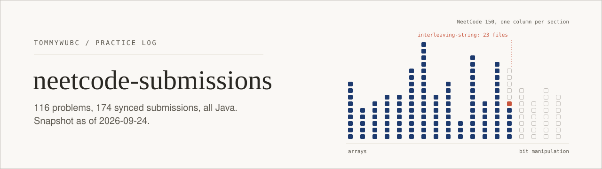

<picture>
  <source media="(prefers-color-scheme: dark)" srcset=".github/assets/banner-dark.svg">
  
</picture>

My algorithms practice log. Every file here was pushed by [NeetCode.io](https://neetcode.io)'s GitHub sync when I submitted a solution, so the repo doubles as a record of how each problem went: first try, or twenty-third.

All solutions are in **Java**.

## by the numbers

Snapshot as of **2026-09-24**, counted from the tree:

| | |
|---|---|
| distinct problems | **116** |
| synced submission files | **174** |
| languages | Java (174 of 174) |
| topic folders | 1 (`Data Structures & Algorithms`) |
| history | 83 earlier solutions bulk-synced on 2026-06-29, then one commit per submission through 2026-09-23 |

NeetCode syncs everything into a single topic folder, so the breakdown below groups problems by the section they belong to on the NeetCode 150 roadmap. The grouping is mine, done by problem name.

| section | solved | files |
|---|---:|---:|
| Arrays & Hashing | 9 / 9 | 10 |
| Two Pointers | 5 / 5 | 5 |
| Sliding Window | 6 / 6 | 6 |
| Stack | 7 / 7 | 7 |
| Binary Search | 7 / 7 | 7 |
| Linked List | 11 / 11 | 11 |
| Trees | 15 / 15 | 15 |
| Heap / Priority Queue | 7 / 7 | 7 |
| Backtracking | 9 / 9 | 9 |
| Tries | 3 / 3 | 6 |
| Graphs | 13 / 13 | 16 |
| Advanced Graphs | 6 / 6 | 17 |
| 1-D Dynamic Programming | 12 / 12 | 14 |
| 2-D Dynamic Programming | 6 / 11 | 44 |
| Greedy, Intervals, Math & Geometry, Bit Manipulation | 0 / 29 | 0 |
| **total** | **116 / 150** | **174** |

Everything up to 1-D DP is done. 2-D DP is in progress, and the last four sections haven't started yet.

## the long tail

Most problems took one synced submission. A few did not:

| problem | files here | highest submission # |
|---|---:|---:|
| [`interleaving-string`](Data%20Structures%20%26%20Algorithms/interleaving-string) | 23 | 24 |
| [`count-paths`](Data%20Structures%20%26%20Algorithms/count-paths) | 13 | 12 |
| [`foreign-dictionary`](Data%20Structures%20%26%20Algorithms/foreign-dictionary) | 8 | 7 |
| [`design-word-search-data-structure`](Data%20Structures%20%26%20Algorithms/design-word-search-data-structure) | 4 | 3 |

`interleaving-string` is the standout: 23 files between 2026-08-31 and 2026-09-23, ending in a memoized top-down DP. It's all there, so you can read the approach being worked out one submission at a time. That's the point of keeping the misses.

The submission number is NeetCode's own counter, and not every attempt made it here. `trapping-rain-water` has one file, and it's `submission-15`.

## layout

NeetCode's convention: topic folder, then problem slug, then one file per synced submission.

```
Data Structures & Algorithms/
  two-integer-sum/
    submission-0.java
  interleaving-string/
    submission-2.java
    ...
    submission-24.java
```

Problem slugs are NeetCode's names, which sometimes differ from LeetCode's (`duplicate-integer` is Contains Duplicate, `eating-bananas` is Koko Eating Bananas).

## notes

- The repo is written to by the sync bot. It only adds files, so this README is the only hand-edited file.
- The numbers above are a snapshot and will fall behind as new submissions sync. To recount:

  ```bash
  ls "Data Structures & Algorithms" | wc -l                       # problems
  find "Data Structures & Algorithms" -type f | wc -l              # submissions
  find "Data Structures & Algorithms" -type f | sed 's/.*\.//' | sort | uniq -c   # by language
  ```

More about me at [tommywubc.github.io](https://tommywubc.github.io).
